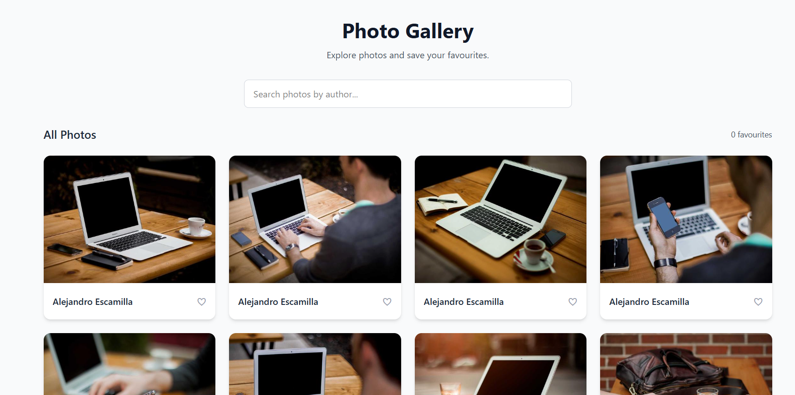

# Photo Gallery Web App

A responsive Photo Gallery application built with React, Vite, and Tailwind CSS as part of the Celebrare Frontend React Internship pre-screening assignment.

Users can browse photos fetched from the Picsum Photos API, search photos by author name, and mark photos as favourites. Favourite photos are saved in localStorage and remain available after refreshing the page.

## Application Screenshot



## Features

- **Fetch Photos:** Fetches 40 photos from the Picsum Photos API.
- **Loading State:** Displays a loading spinner while photos are being fetched.
- **Error Handling:** Displays an error message if the API request fails.
- **Responsive Grid:** Displays photos in a responsive layout:
  - Mobile: 1 column
  - Tablet: 2 columns
  - Desktop: 4 columns
- **Search Photos:** Filters photos by author name in real time without making additional API requests.
- **Favourites:** Add or remove photos from favourites using a heart button.
- **Persistent Favourites:** Saves favourites in localStorage so they persist across page refreshes.
- **Custom Hook:** Uses `useFetchPhotos` to separate API-fetching logic from the UI.
- **State Management:** Uses `useReducer` to manage favourite photos.
- **Performance Optimization:** Uses `useCallback` for the search handler and `useMemo` to calculate filtered photos.

## Technologies Used

- React
- Vite
- JavaScript
- Tailwind CSS
- React Hooks: `useState`, `useEffect`, `useReducer`, `useCallback`, and `useMemo`
- Fetch API
- Browser localStorage
- Picsum Photos API

## API Used

The application fetches photos from:

https://picsum.photos/v2/list?limit=30

The API provides photo information, including the photo ID, author name, and image URLs.

## Project Structure

```text
photo-gallery/
├── src/
│   ├── components/
│   │   ├── Gallery.jsx
│   │   ├── PhotoCard.jsx
│   │   └── SearchBar.jsx
│   ├── hooks/
│   │   └── useFetchPhotos.js
│   ├── reducers/
│   │   └── favoritesReducers.js
│   ├── App.jsx
│   ├── index.css
│   └── main.jsx
├── index.html
├── package.json
└── vite.config.js
```

## Getting Started

### Prerequisites

- Node.js
- npm
- Git

### Installation

1. Clone the repository:

   ```bash
   git clone https://github.com/NalinaDevdasMeshram/celebrare.git
   ```

2. Navigate to the project directory:

   ```bash
   cd photo-gallery
   ```

3. Install dependencies:

   ```bash
   npm install
   ```

4. Start the development server:

   ```bash
   npm run dev
   ```

5. Open the local URL displayed in your terminal.

## How It Works

### Fetching Photos

The `useFetchPhotos` custom hook fetches photos from the Picsum Photos API and manages the photos, loading, and error states.

### Searching Photos

The search input filters the already-fetched photos by author name as the user types. No additional API request is made during searching.

### Managing Favourites

The `favoritesReducers` reducer handles the `TOGGLE_FAVORITE` action. It adds a photo to favourites if it is not already saved or removes it if it is already a favourite.

Favourites are initialized from localStorage and saved whenever the favourites state changes.

### Performance Hooks

- `useCallback` keeps the search handler's function reference stable between renders.
- `useMemo` caches the filtered photo list until the photos or search query changes.
